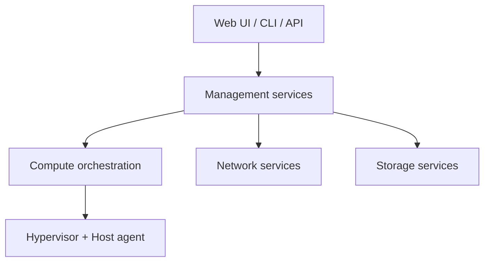

# apache/cloudstack

> Open-source IaaS platform for deploying and managing large fleets of virtual machines.

## The problem
Offering a public or private cloud requires orchestrating compute, network and storage across several hypervisors.

## What it actually does
A "turnkey" solution: compute orchestration, networking as a service, accounts and projects, resource accounting, a complete native API and a web interface. Supported hypervisors: VMware vSphere, KVM, XenServer, XenProject, Hyper-V, OVM and LXC containers. Requires a MySQL-compatible database (MariaDB or MySQL). The diagram is only partially verified.

## How it is wired

## Trying it
No command in the README; it points to INSTALL.md and a demo (`qa.cloudstack.cloud/simulator`, admin:password).

## Cost and gotchas
The software is free but infrastructure, the MySQL database and operations skills are at your expense. 1,214 open issues. Cryptographic software notice (ECCN 5D002) to check depending on your country.

## What it is not
Not a hosted cloud service nor an MLOps tool: it is what you use to build a cloud.

## Alternatives
No alternative named in the README.

## For you
Ignore unless you operate your own private cloud for GPU compute: otherwise, the operating burden far exceeds the need.
