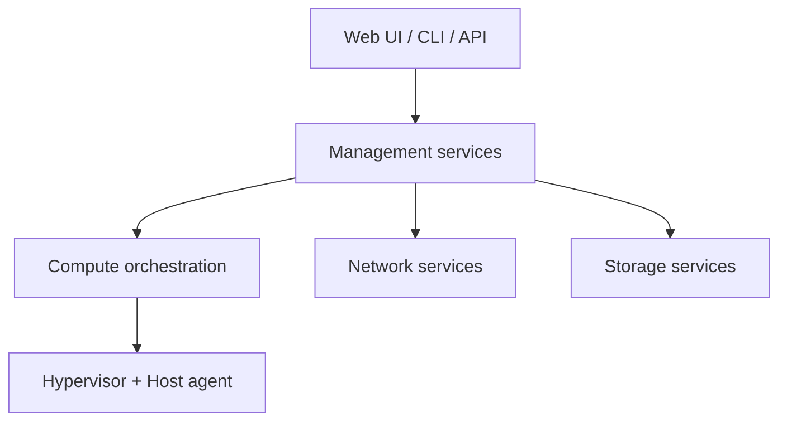

# apache/cloudstack

> Plateforme IaaS open source pour déployer et gérer de grands parcs de machines virtuelles.

## Le problème
Offrir un cloud public ou privé impose d'orchestrer calcul, réseau et stockage sur plusieurs hyperviseurs.

## Ce que ça fait vraiment
Solution « clé en main » : orchestration du calcul, réseau en service, comptes et projets, comptabilité des ressources, API native complète et interface web. Hyperviseurs pris en charge : VMware vSphere, KVM, XenServer, XenProject, Hyper-V, OVM et conteneurs LXC. Exige une base compatible MySQL (MariaDB ou MySQL). Le diagramme n'est que partiellement vérifié.

## Comment c'est branché

## Essayer
Aucune commande dans le README ; il renvoie à INSTALL.md et à une démo (`qa.cloudstack.cloud/simulator`, admin:password).

## Coût et pièges
Logiciel gratuit mais infrastructure, base MySQL et compétences d'exploitation à ta charge. 1 214 issues ouvertes. Notice de logiciel cryptographique (ECCN 5D002) à vérifier selon ton pays.

## Ce que ce n'est pas
Pas un service cloud hébergé ni un outil MLOps : c'est ce qui sert à construire un cloud.

## Alternatives
Aucune alternative nommée dans le README.

## Pour toi
À ignorer sauf si tu opères ton propre cloud privé pour du calcul GPU : sinon, la charge d'exploitation dépasse largement le besoin.

