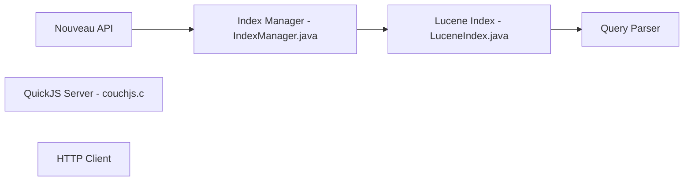

# apache/couchdb

> JSON document database exposed over HTTP, with clustering, for application developers.

## The problem
Store and synchronize JSON documents through an HTTP API without an SQL engine.

## What it actually does
The README mostly documents installation (INSTALL.Unix/Windows), a three-node dev cluster (`./dev/run`) and a verification assistant. The architecture extracted from the code only covers Nouveau (Lucene indexing service) and several JavaScript query-server engines (SpiderMonkey 1.8.5 to 102, QuickJS). General HTTP routing was not sampled.

## How it is wired


## Trying it
```bash
./configure && make
./dev/run
./dev/run --admin=admin:admin
make check
```

## Cost and gotchas
Compilation from source or devcontainer (Docker + VS Code). The README does not detail production configuration.

## What it is not
No rich functional description in the README: everything goes through the external documentation.

## Alternatives
No alternative named in the README.

## For you
Worth watching: interesting for offline document synchronization; otherwise little related to data/AI.
