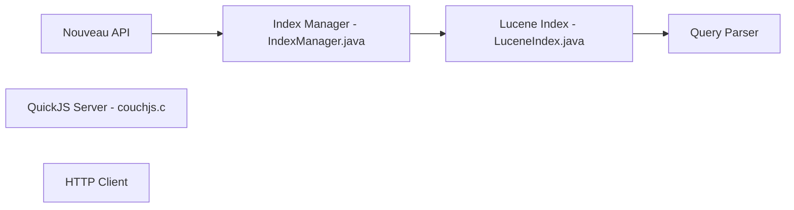

# apache/couchdb

> Base de données de documents JSON exposée en HTTP, avec grappe, pour développeurs d'applications.

## Le problème
Stocker et synchroniser des documents JSON via une API HTTP sans moteur SQL.

## Ce que ça fait vraiment
Le README documente surtout l'installation (INSTALL.Unix/Windows), un cluster de dev à trois nœuds (`./dev/run`) et un assistant de vérification. L'architecture extraite du code ne couvre que Nouveau (service d'indexation Lucene) et plusieurs moteurs JavaScript de serveur de requêtes (SpiderMonkey 1.8.5 à 102, QuickJS). Le routage HTTP général n'a pas été échantillonné.

## Comment c'est branché


## Essayer
```bash
./configure && make
./dev/run
./dev/run --admin=admin:admin
make check
```

## Coût et pièges
Compilation depuis les sources ou devcontainer (Docker + VS Code). Le README ne détaille pas la configuration de production.

## Ce que ce n'est pas
Pas de description fonctionnelle riche dans le README : tout passe par la documentation externe.

## Alternatives
Aucune alternative nommée dans le README.

## Pour toi
À surveiller : intéressant pour de la synchro de documents hors ligne ; sinon peu lié à data/IA.

