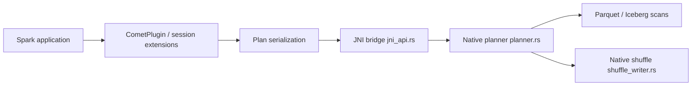

# apache/datafusion-comet

> Accelerator for Apache Spark that executes plans in Arrow columns via Rust/DataFusion, without changing the code.

## The problem
Spark SQL/DataFrame queries pay the cost of the row-based engine and consume a lot of cluster. Rewriting the jobs is not an option.

## What it actually does
A Spark plugin replaces operators and expressions with native Rust (DataFusion) or JVM versions on Arrow batches: Parquet and Iceberg scans, Arrow-IPC columnar shuffle, joins, aggregations, Scala/Java UDFs. The README claims about a 1.8x gain on TPC-DS SF1000 against Spark 4.2 (the author's figure). Spark 3.4 to 4.2 supported. Unsupported cases fall back to Spark.

## How it is wired


## Trying it
```bash
export COMET_JAR=/path/to/comet-spark-spark3.5_2.12-<version>.jar
$SPARK_HOME/bin/spark-shell \
    --jars $COMET_JAR \
    --conf spark.driver.extraClassPath=$COMET_JAR \
    --conf spark.executor.extraClassPath=$COMET_JAR \
    --conf spark.plugins=org.apache.spark.CometPlugin \
    --conf spark.shuffle.manager=org.apache.spark.sql.comet.execution.shuffle.CometShuffleManager \
    --conf spark.memory.offHeap.enabled=true \
    --conf spark.memory.offHeap.size=4g
```

## Cost and gotchas
No GPU or special hardware. Off-heap memory (4g in the example) and memoryOverhead are needed. 861 open issues: operator coverage is evolving, check the official lists.

## What it is not
Not a new standalone query engine: it relies on an existing Spark. The announced gain depends on the workload and is not guaranteed.

## Alternatives
- NVIDIA cuDF plugin (spark-rapids): GPU acceleration, preferable if you have GPUs (outside the README, to be verified).
- Apache DataFusion alone to query without Spark.

## For you
Worth watching and testing on an expensive Spark job: a cluster cost gain with no code change deserves a measurement, to be confirmed on your data.
