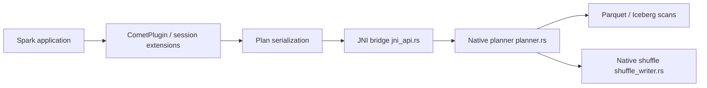

# apache/datafusion-comet

> Accélérateur pour Apache Spark qui exécute les plans en colonnes Arrow via Rust/DataFusion, sans changer le code.

## Le problème
Les requêtes Spark SQL/DataFrame paient le coût du moteur par lignes et consomment beaucoup de cluster. Réécrire les jobs n'est pas envisageable.

## Ce que ça fait vraiment
Un plugin Spark remplace des opérateurs et expressions par des versions natives Rust (DataFusion) ou JVM sur batches Arrow : scans Parquet et Iceberg, shuffle colonne Arrow-IPC, jointures, agrégations, UDF Scala/Java. Le README annonce environ 1,8x de gain sur TPC-DS SF1000 face à Spark 4.2 (chiffre de l'auteur). Spark 3.4 à 4.2 supportés. Les cas non supportés basculent sur Spark.

## Comment c'est branché


## Essayer
```bash
export COMET_JAR=/path/to/comet-spark-spark3.5_2.12-<version>.jar
$SPARK_HOME/bin/spark-shell \
    --jars $COMET_JAR \
    --conf spark.driver.extraClassPath=$COMET_JAR \
    --conf spark.executor.extraClassPath=$COMET_JAR \
    --conf spark.plugins=org.apache.spark.CometPlugin \
    --conf spark.shuffle.manager=org.apache.spark.sql.comet.execution.shuffle.CometShuffleManager \
    --conf spark.memory.offHeap.enabled=true \
    --conf spark.memory.offHeap.size=4g
```

## Coût et pièges
Pas de GPU ni matériel spécial. Il faut de la mémoire off-heap (4g dans l'exemple) et du memoryOverhead. 861 issues ouvertes : la couverture des opérateurs évolue, vérifier les listes officielles.

## Ce que ce n'est pas
Pas un nouveau moteur de requête autonome : il s'appuie sur un Spark existant. Le gain annoncé dépend de la charge et n'est pas garanti.

## Alternatives
- NVIDIA cuDF plugin (spark-rapids) : accélération par GPU, à préférer si tu as des GPU (hors README, à vérifier).
- Apache DataFusion seul pour requêter sans Spark.

## Pour toi
À surveiller et tester sur un job Spark coûteux : un gain de coût de cluster sans changement de code vaut une mesure, à confirmer sur tes données.

