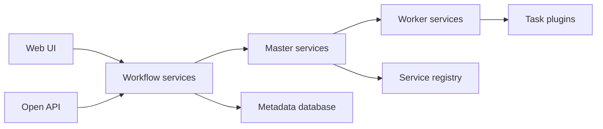

# apache/dolphinscheduler

> Distributed, low-code data workflow orchestration platform for data teams.

## The problem
Chaining pipeline tasks with dependencies, retries and history, without scattered cron scripts.

## What it actually does
Workflows are defined through a drag-and-drop interface, a Python SDK or an open API. Master services distribute tasks to workers, with a service registry and a metadata database. Task types, data sources and alert channels are plugins. Workflow versioning, backfill, multi-tenant. Standalone, cluster, Docker or Kubernetes deployment.

## How it is wired

## Trying it
No command documented in the README: it lists startup modes (standalone, Docker, Kubernetes, Terraform) by link to the documentation.

## Cost and gotchas
Free, but several components to operate (masters, workers, registry, database). The advertised performance is not quantified.

## What it is not
Not a compute engine: it schedules and launches tasks, it does not execute them itself on data.

## Alternatives
No alternative named in the README.

## For you
Worth watching: a serious orchestration option if you want a low-code UI; compare it with your current tools before any migration.
