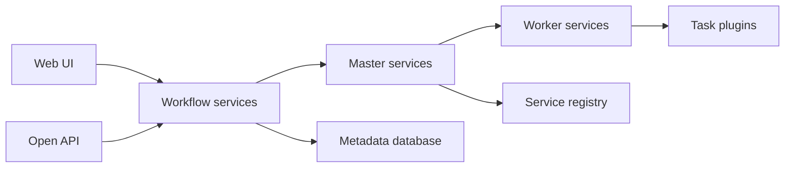

# apache/dolphinscheduler

> Plateforme d'orchestration de workflows de données à faible code, distribuée, pour équipes data.

## Le problème
Enchaîner des tâches de pipelines avec dépendances, reprises et historique, sans scripts cron dispersés.

## Ce que ça fait vraiment
Les workflows se définissent par interface glisser-déposer, SDK Python ou API ouverte. Des services master répartissent les tâches vers des workers, avec registre de services et base de métadonnées. Types de tâches, sources de données et canaux d'alerte sont des plugins. Versionnage des workflows, reprise (backfill), multi-tenant. Déploiement standalone, cluster, Docker ou Kubernetes.

## Comment c'est branché

## Essayer
Aucune commande documentée dans le README : il liste des modes de démarrage (standalone, Docker, Kubernetes, Terraform) par lien vers la documentation.

## Coût et pièges
Gratuit, mais plusieurs composants à exploiter (masters, workers, registre, base). La performance annoncée n'est pas chiffrée.

## Ce que ce n'est pas
Pas un moteur de calcul : il planifie et lance des tâches, il ne les exécute pas lui-même sur des données.

## Alternatives
Aucune alternative nommée dans le README.

## Pour toi
Surveiller : option sérieuse d'orchestration si tu cherches une UI low-code ; à comparer à tes outils actuels avant toute migration.

