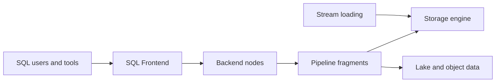

# apache/doris

> Real-time MySQL-compatible MPP analytical database, for data warehouse, lakehouse and log analytics.

## The problem
Serving sub-second analytical queries at high concurrency without stacking several systems (warehouse, cache, lake).

## What it actually does
Two process types: Frontend (SQL, planning, metadata) and Backend (columnar storage, vectorized pipeline execution). MySQL protocol, indexes (inverted, Bloom, min/max), Duplicate, Unique and Aggregate models, materialized views, federated queries over Hive, Iceberg, Hudi, Kafka and MySQL binlog ingestion, hybrid search (text, vectors).

## How it is wired

## Trying it
No command in the README; it points to the documentation, the download and the build.

## Cost and gotchas
Free; a cluster to operate (FE and BE), significant memory. The README does not quantify resources.

## What it is not
Not a transactional database. The performance figures (5 to 10 times) come from the README, unverified.

## Alternatives
No alternative named in the README.

## For you
Watch: relevant if you serve dashboards or real-time analytical features; otherwise DuckDB or a managed warehouse is enough.
