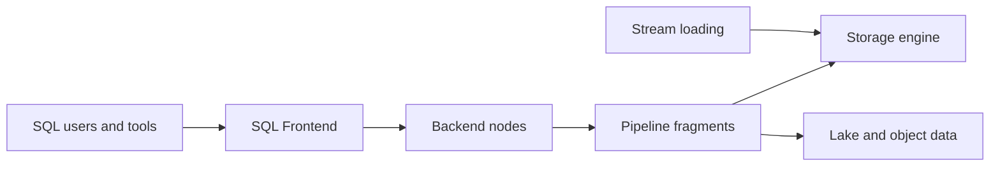

# apache/doris

> Base analytique MPP temps réel compatible MySQL, pour entrepôt de données, lakehouse et analyse de logs.

## Le problème
Servir des requêtes analytiques sous la seconde à forte concurrence sans empiler plusieurs systèmes (entrepôt, cache, lac).

## Ce que ça fait vraiment
Deux types de processus : Frontend (SQL, planification, métadonnées) et Backend (stockage colonnaire, exécution vectorisée en pipeline). Protocole MySQL, index (inversé, Bloom, min/max), modèles Duplicate, Unique, Aggregate, vues matérialisées, requêtes fédérées sur Hive, Iceberg, Hudi, import Kafka et binlog MySQL, recherche hybride (texte, vecteurs).

## Comment c'est branché

## Essayer
Aucune commande dans le README ; renvoi à la documentation, au téléchargement et à la compilation.

## Coût et pièges
Gratuit ; cluster à exploiter (FE et BE), mémoire importante. Le README ne chiffre pas les ressources.

## Ce que ce n'est pas
Pas une base transactionnelle. Les chiffres de performance (5 à 10 fois) viennent du README, non vérifiés.

## Alternatives
Aucune alternative nommée dans le README.

## Pour toi
À surveiller : pertinent si tu sers des tableaux de bord ou des features analytiques en temps réel ; sinon DuckDB ou un entrepôt géré suffit.

