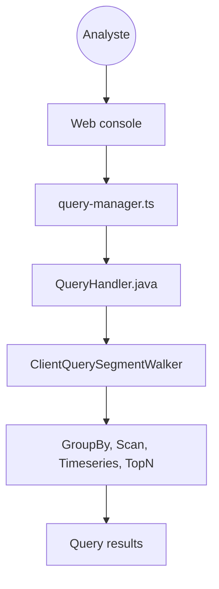

# apache/druid

> Real-time analytics database for fast, highly concurrent queries on streaming or batch data.

## The problem
Classic data warehouses handle ad hoc, low-latency, highly concurrent queries on fresh data poorly.

## What it actually does
Streaming and batch ingestion, SQL and native queries over HTTP, JDBC and gRPC, and a web console to load data, manage the cluster and run queries. According to the code, the SQL planner sends queries to the GroupBy, Scan, Timeseries and TopN engines, and a multi-stage engine (MSQ) exists. Building requires JDK 25.

## How it is wired

## Trying it
The README gives no command: it points to the local or Docker quickstart and the documentation. Not documented here.

## Cost and gotchas
Free, but a Druid cluster is heavy to operate. Kubernetes goes through a separate repository (druid-operator).

## What it is not
Not a universal warehouse replacement: the README presents it as an alternative for certain uses. Not a lightweight tool.

## Alternatives
No alternative named in the README.

## For you
Worth watching: relevant if you serve real-time dashboards at large scale, otherwise oversized for one-off analyses.
