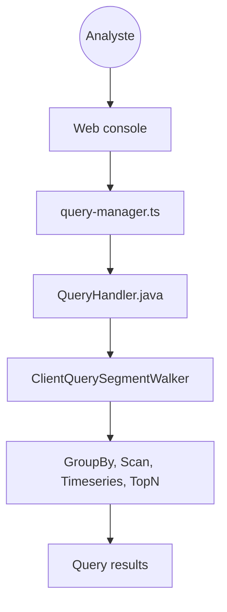

# apache/druid

> Base de données analytique temps réel pour requêtes rapides à forte concurrence sur données en flux ou par lots.

## Le problème
Les entrepôts classiques répondent mal aux requêtes ad hoc à faible latence et à forte concurrence sur des données fraîches.

## Ce que ça fait vraiment
Ingestion en continu et par lots, requêtes SQL et natives via HTTP, JDBC et gRPC, console web pour charger les données, gérer le cluster et lancer des requêtes. D'après le code, le planificateur SQL envoie les requêtes aux moteurs GroupBy, Scan, Timeseries et TopN, et un moteur multi-étapes (MSQ) existe. Compiler exige JDK 25.

## Comment c'est branché

## Essayer
Le README ne donne pas de commande : il renvoie vers le démarrage rapide local ou Docker et la documentation. Non documenté ici.

## Coût et pièges
Gratuit, mais un cluster Druid est lourd à exploiter. Kubernetes passe par un dépôt séparé (druid-operator).

## Ce que ce n'est pas
Pas un remplaçant universel d'entrepôt : le README le présente comme alternative pour certains usages. Pas un outil léger.

## Alternatives
Aucune alternative nommée dans le README.

## Pour toi
À surveiller : pertinent si tu sers des tableaux de bord temps réel à grande échelle, sinon démesuré pour des analyses ponctuelles.

