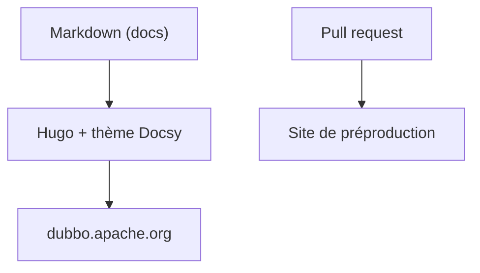

# apache/dubbo-website

> Sources of the official Apache Dubbo website, built with Hugo and the Docsy theme.

## The problem
Dubbo's documentation must live in a repository anyone can contribute to and be published on dubbo.apache.org.

## What it actually does
Contains the Markdown files of the documentation. Hugo (extended version) turns them into a site with the Docsy theme, and PostCSS is required. Pull requests target the master branch and a staging site is created automatically.

## How it is wired
Simplified diagram based on the sheet, no diagram provided.


## Trying it
```bash
git clone https://github.com/apache/dubbo-website.git
hugo mod clean
hugo server --disableFastRender
```

## Cost and gotchas
Free. Extended Hugo, Go and Node.js are required; if module downloads get stuck, the README suggests a GOPROXY proxy. 303 open issues.

## What it is not
Not the Dubbo framework: only its documentation site.

## Alternatives
No alternative named in the README.

## For you
Ignore: documentation repository of a Java RPC framework, of no use for a data/AI/MLOps profile.
