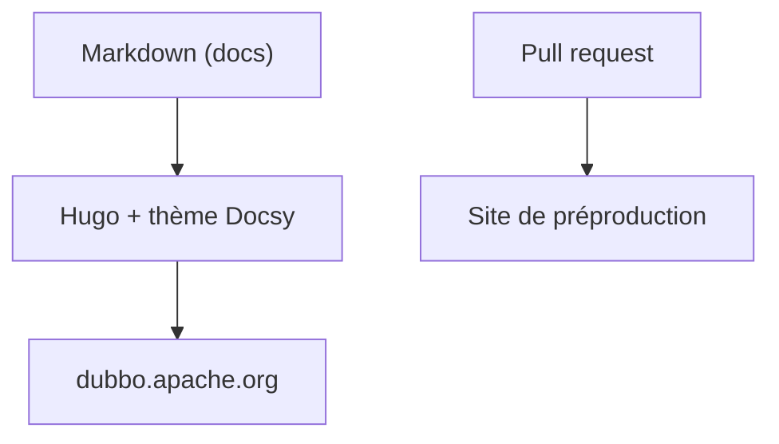

# apache/dubbo-website

> Sources du site officiel d'Apache Dubbo, construit avec Hugo et le thème Docsy.

## Le problème
La documentation de Dubbo doit vivre dans un dépôt contribuable et se publier sur dubbo.apache.org.

## Ce que ça fait vraiment
Contient les fichiers Markdown de la documentation. Hugo (version étendue) les transforme en site avec le thème Docsy, et PostCSS est requis. Les pull requests visent la branche master et un site de préproduction est créé automatiquement.

## Comment c'est branché
Schéma simplifié d'après la fiche, sans diagramme fourni.


## Essayer
```bash
git clone https://github.com/apache/dubbo-website.git
hugo mod clean
hugo server --disableFastRender
```

## Coût et pièges
Gratuit. Il faut Hugo étendu, Go et Node.js ; en cas de blocage au téléchargement des modules, le README propose un proxy GOPROXY. 303 issues ouvertes.

## Ce que ce n'est pas
Pas le framework Dubbo : seulement son site de documentation.

## Alternatives
Aucune alternative nommée dans le README.

## Pour toi
À ignorer : dépôt de documentation d'un framework RPC Java, sans usage pour un profil data/IA/MLOps.

