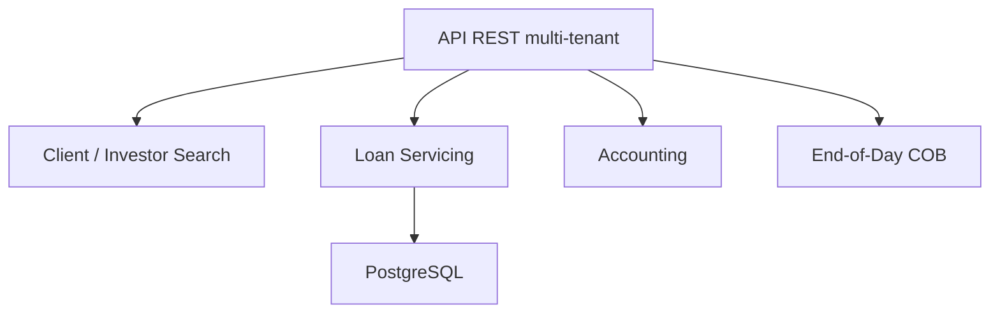

# apache/fineract

> Open source core banking platform exposed as an API, for financial institutions.

## The problem
Building a banking core (accounts, loans, savings, accounting) from scratch is expensive.

## What it actually does
Multi-tenant Java (Spring Boot) service exposing a REST API with no user interface: clients, loans, savings, general ledger, provisioning, end-of-day processing (COB). PostgreSQL recommended (MySQL/MariaDB deprecated, driver to be supplied). Optional business events to ActiveMQ or Kafka.

## How it is wired


## Trying it
```bash
./gradlew createPGDB -PdbName=fineract_tenants
./gradlew createPGDB -PdbName=fineract_default
./gradlew devRun
curl --insecure https://localhost:8443/fineract-provider/actuator/health
```

## Cost and gotchas
Free, but the Docker images are NOT production-ready (`test` profile enabled); production deployment is complex and at your expense. A web client (Mifos) is separate.

## What it is not
Not a finished banking application: an API, with no interface.

## Alternatives
No alternative named in the README.

## For you
Ignore unless you have a fintech project: banking domain with no direct link to data/AI, with a high operating cost.
