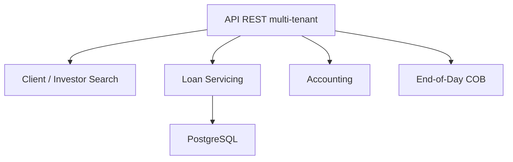

# apache/fineract

> Plateforme open source de core banking exposée en API, pour institutions financières.

## Le problème
Construire un cœur bancaire (comptes, prêts, épargne, comptabilité) de zéro est coûteux.

## Ce que ça fait vraiment
Service Java (Spring Boot) multi-locataire exposant une API REST sans interface utilisateur : clients, prêts, épargne, comptabilité générale, provisionnement, traitement de fin de journée (COB). PostgreSQL recommandé (MySQL/MariaDB dépréciés, driver à fournir). Événements métier optionnels vers ActiveMQ ou Kafka.

## Comment c'est branché


## Essayer
```bash
./gradlew createPGDB -PdbName=fineract_tenants
./gradlew createPGDB -PdbName=fineract_default
./gradlew devRun
curl --insecure https://localhost:8443/fineract-provider/actuator/health
```

## Coût et pièges
Gratuit, mais les images Docker ne sont PAS prêtes pour la production (profil `test` activé) ; le déploiement en production est complexe et à ta charge. Un client web (Mifos) est séparé.

## Ce que ce n'est pas
Pas une application bancaire finie : une API, sans interface.

## Alternatives
Aucune alternative nommée dans le README.

## Pour toi
À ignorer sauf projet fintech : domaine bancaire sans lien direct avec data/IA, avec un coût d'exploitation élevé.

