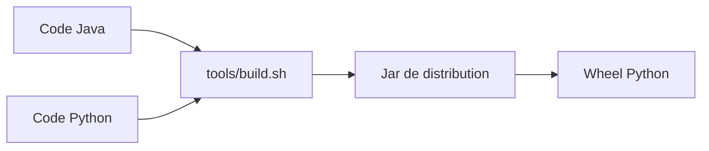

# apache/flink-agents

> AI agent framework built on Apache Flink, for teams already equipped with Flink.

## The problem
Running AI agents on Flink data streams without rebuilding the orchestration alongside.

## What it actually does
The README is only a few lines long: it announces an agent framework on top of Flink and describes the build. Detailed operation is deferred to the user documentation, not provided here.

## How it is wired
Simplified diagram based on the sheet, no diagram provided.


## Trying it
```bash
git clone https://github.com/apache/flink-agents.git
./tools/build.sh
```

## Cost and gotchas
Free, but you need Maven, Java 11+ and Python 3.10 to 3.12; since Java is not in the list of prerequisites, it is the real need to plan for. No package installation is documented here.

## What it is not
Not a turnkey product: the README shows no agent example. No data on supported models or providers.

## Alternatives
No alternative named in the README.

## For you
Worth watching: interesting if your data foundation is Flink, but the README does not allow judging maturity.
