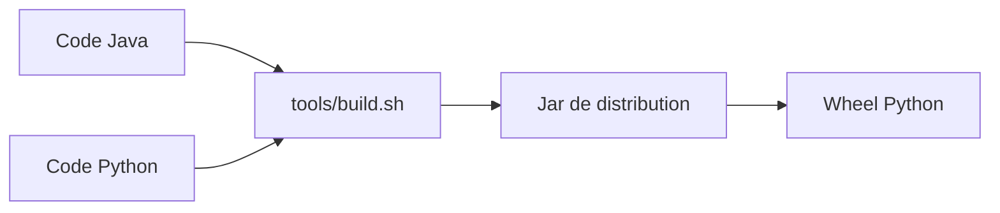

# apache/flink-agents

> Cadre d'agents IA bâti sur Apache Flink, pour des équipes déjà équipées Flink.

## Le problème
Faire tourner des agents IA sur des flux de données Flink sans reconstruire l'orchestration à côté.

## Ce que ça fait vraiment
Le README tient en quelques lignes : il annonce un cadre d'agents au-dessus de Flink et décrit la compilation. Le fonctionnement détaillé est renvoyé à la documentation utilisateur, non fournie ici.

## Comment c'est branché
Schéma simplifié d'après la fiche, sans diagramme fourni.


## Essayer
```bash
git clone https://github.com/apache/flink-agents.git
./tools/build.sh
```

## Coût et pièges
Gratuit, mais il faut Maven, Java 11+ et Python 3.10 à 3.12 ; Java n'étant pas dans la liste des prérequis, c'est le vrai besoin à prévoir. Aucune installation par paquet n'est documentée ici.

## Ce que ce n'est pas
Pas un produit clé en main : le README ne montre aucun exemple d'agent. Aucune donnée sur les modèles ou fournisseurs pris en charge.

## Alternatives
Aucune alternative nommée dans le README.

## Pour toi
À surveiller : intéressant si ton socle de données est Flink, mais le README ne permet pas de juger la maturité.

