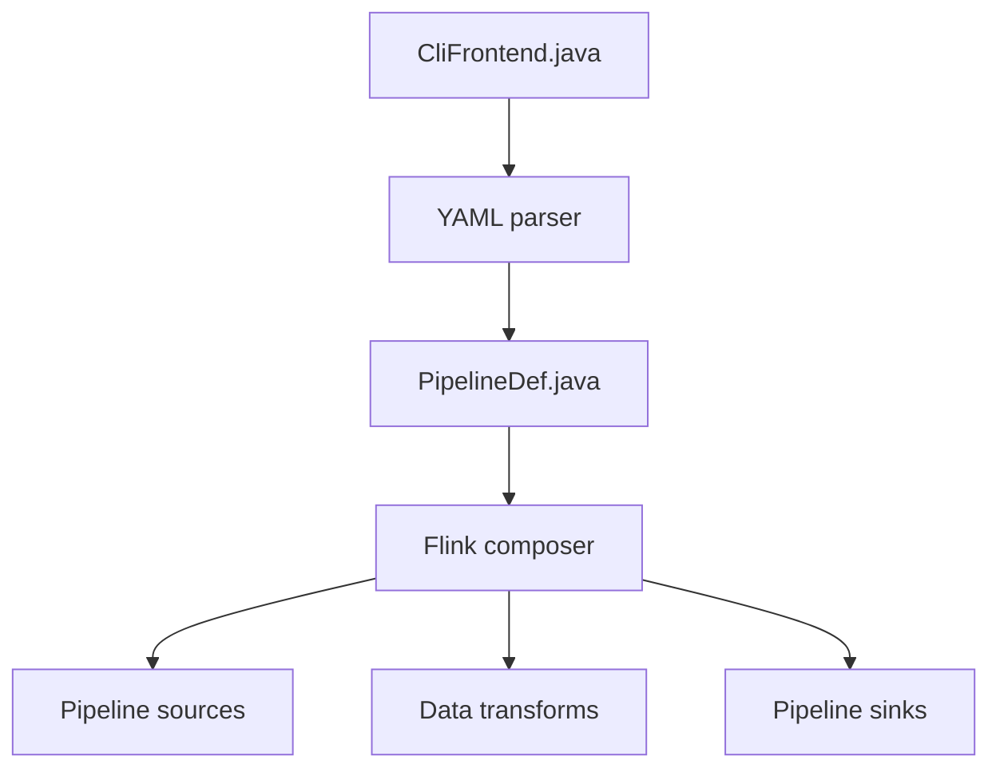

# apache/flink-cdc

> Real-time and batch data integration tool on Apache Flink, for synchronizing databases.

## The problem
Synchronizing whole databases into a warehouse or analytics engine, with changing schemas, requires a lot of code.

## What it actually does
Three API levels: a no-code YAML pipeline (source, sink, routing, transformation, schema evolution) launched via `flink-cdc.sh`, a SQL API for Flink SQL and a DataStream API. Pipeline connectors: Doris, Kafka, Iceberg, Paimon, StarRocks, MySQL, PostgreSQL and others. Support depends on the Flink version.

## How it is wired
Diagram taken from the code, simplified.



## Trying it
```bash
# non documenté en commande : le README donne un exemple YAML
# soumis via le script flink-cdc.sh (voir le Quickstart)
```

## Cost and gotchas
Free, but you need a Flink cluster compatible with the right version. The README notes that the YAML pipeline requires Flink 1.17+ and ignores the 1.x and 2.x versions of CDC.

## What it is not
Not a managed or standalone service: it runs on Flink. Connector details are not described in the README.

## Alternatives
No alternative named in the README.

## For you
Worth watching: very useful for continuously feeding a warehouse or feature store if you already have Flink, too heavy otherwise.
