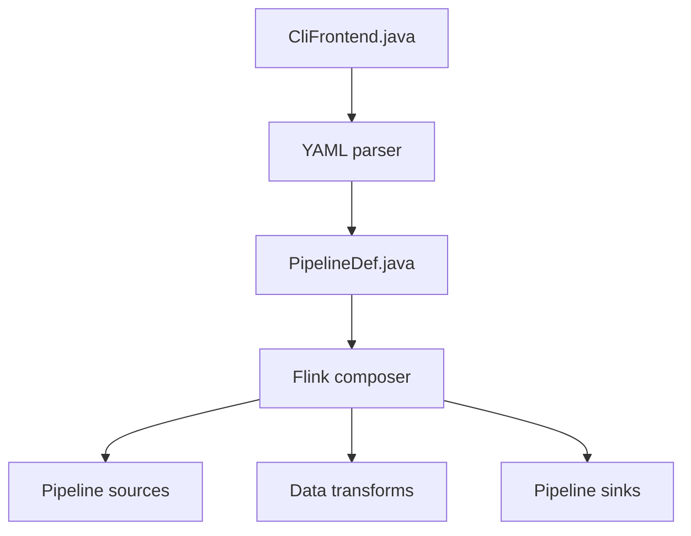

# apache/flink-cdc

> Outil d'intégration de données temps réel et batch sur Apache Flink, pour synchroniser des bases.

## Le problème
Synchroniser des bases entières vers un entrepôt ou un moteur d'analyse, avec schémas qui changent, exige beaucoup de code.

## Ce que ça fait vraiment
Trois niveaux d'API : un pipeline YAML sans code (source, sink, routage, transformation, évolution de schéma) lancé via `flink-cdc.sh`, une API SQL pour Flink SQL et une API DataStream. Connecteurs de pipeline : Doris, Kafka, Iceberg, Paimon, StarRocks, MySQL, PostgreSQL et d'autres. Le support dépend de la version de Flink.

## Comment c'est branché
Diagramme tiré du code, simplifié.



## Essayer
```bash
# non documenté en commande : le README donne un exemple YAML
# soumis via le script flink-cdc.sh (voir le Quickstart)
```

## Coût et pièges
Gratuit, mais il faut un cluster Flink compatible avec la bonne version. Le README note que le pipeline YAML exige Flink 1.17+ et ignore les versions 1.x et 2.x de CDC.

## Ce que ce n'est pas
Pas un service géré ni autonome : il tourne sur Flink. Les détails des connecteurs ne sont pas décrits dans le README.

## Alternatives
Aucune alternative nommée dans le README.

## Pour toi
À surveiller : très utile pour alimenter un entrepôt ou un feature store en continu si tu as déjà Flink, trop lourd sinon.

