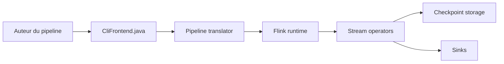

# apache/flink

> Stream and batch processing framework, for data engineers who want real time.

## The problem
Processing large volumes of events with low latency, state, and fault-tolerance guarantees.

## What it actually does
Stream-oriented runtime that also runs batch; DataStream API in Java, event time and out-of-order data, windows (time, count, session), exactly-once, backpressure. Libraries for graphs, ML (batch) and CEP. Connectors are externalized into separate Apache repositories (Kafka, JDBC, Hive…).

## How it is wired


## Trying it
```bash
git clone https://github.com/apache/flink.git
cd flink
./mvnw clean package -DskipTests -Djdk17 -Pjava17-target
```

## Cost and gotchas
Free. Build takes ~10 minutes, Maven 3.9.16, Java 11/17/21. A production cluster still has to be operated.

## What it is not
The README does not document cluster deployment; it shows Java examples. Connectors are not in this repository.

## Alternatives
No alternative named in the README.

## For you
A reference for large-scale streaming; worth watching if your data arrives as streams, otherwise a simpler batch is enough.
