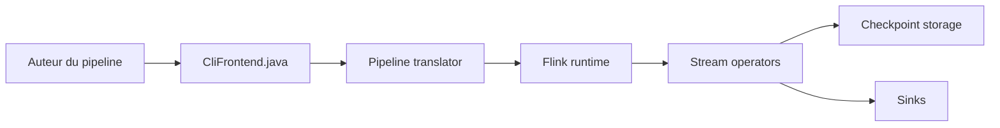

# apache/flink

> Framework de traitement de flux et de lots, pour ingénieurs data qui veulent du temps réel.

## Le problème
Traiter de gros volumes d'événements avec latence faible, état et garanties de tolérance aux pannes.

## Ce que ça fait vraiment
Runtime orienté flux qui exécute aussi le batch ; API DataStream en Java, temps d'événement et données hors ordre, fenêtres (temps, nombre, session), exactly-once, contre-pression. Bibliothèques de graphes, ML (batch) et CEP. Les connecteurs sont externalisés dans des dépôts Apache séparés (Kafka, JDBC, Hive…).

## Comment c'est branché


## Essayer
```bash
git clone https://github.com/apache/flink.git
cd flink
./mvnw clean package -DskipTests -Djdk17 -Pjava17-target
```

## Coût et pièges
Gratuit. Build ~10 minutes, Maven 3.9.16, Java 11/17/21. Un cluster en production reste à opérer.

## Ce que ce n'est pas
Le README ne documente pas de déploiement cluster ; il montre des exemples Java. Les connecteurs ne sont pas dans ce dépôt.

## Alternatives
Aucune alternative nommée dans le README.

## Pour toi
Référence pour du streaming à grande échelle ; à surveiller si tes données arrivent en flux, sinon un batch plus simple suffit.

