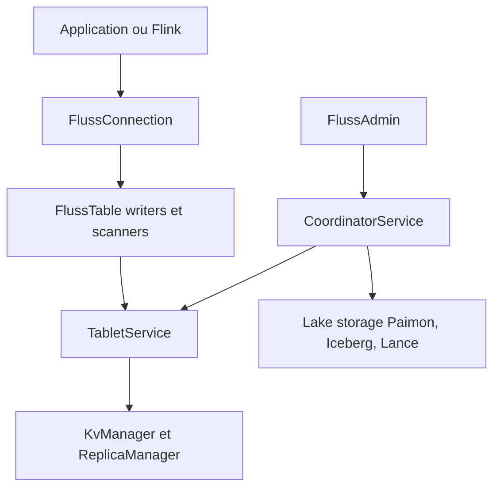

# apache/fluss

> A real-time, columnar streaming storage that serves as a data layer for lakehouse, Flink and Spark.

## The problem
Between a streaming system and a lakehouse, data arrives late or is stored twice, which hurts real-time analytics.

## What it actually does
Fluss stores streaming tables based on Apache Arrow, with column pruning and filters pushed down to storage. It handles keys and values, changelogs, partial updates and deduplication. It makes data converge toward lakes (Paimon, Iceberg, Lance, Hudi) and integrates with Flink and Spark. Clients write, scan or look up by key, and a coordinator and tablet services manage the cluster.

## How it is wired


## Trying it
```bash
git clone https://github.com/apache/fluss.git
cd fluss
./mvnw clean package -DskipTests
```

## Cost and gotchas
Maven build with Java 11 and a JDK 17 for the Iceberg plugin. The README does not describe cluster deployment. More than 1,100 open issues.

## What it is not
Not a general-purpose database nor a plain Kafka replacement: it is a storage layer to be connected to a compute engine. The StarRocks integration is announced as coming.

## Alternatives
No alternative named in the README.

## For you
To watch: relevant if you build real-time pipelines and feature stores with Flink, but running a cluster is heavy and the README gives few deployment pointers.
