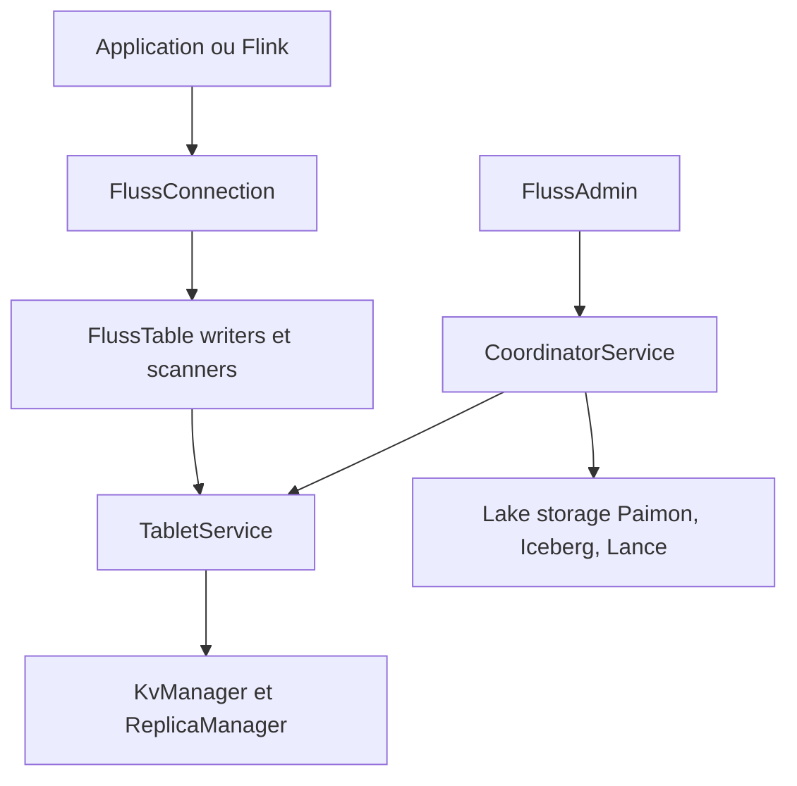

# apache/fluss

> Un stockage de flux temps réel, colonnaire, qui sert de couche de données pour lakehouse, Flink et Spark.

## Le problème
Entre un système de streaming et un lakehouse, les données arrivent en retard ou en double stockage, ce qui nuit aux analyses en temps réel.

## Ce que ça fait vraiment
Fluss stocke des tables en flux, basées sur Apache Arrow, avec élagage de colonnes et filtres poussés vers le stockage. Il gère clés et valeurs, changelogs, mises à jour partielles et dédoublonnage. Il fait converger les données vers des lacs (Paimon, Iceberg, Lance, Hudi) et s'intègre à Flink et Spark. Les clients écrivent, balaient ou cherchent par clé, un coordinateur et des services de tablettes gèrent le cluster.

## Comment c'est branché


## Essayer
```bash
git clone https://github.com/apache/fluss.git
cd fluss
./mvnw clean package -DskipTests
```

## Coût et pièges
Compilation Maven avec Java 11 et un JDK 17 pour le plugin Iceberg. Le README ne décrit pas le déploiement du cluster. Plus de 1 100 tickets ouverts.

## Ce que ce n'est pas
Pas une base de données généraliste ni un remplaçant de Kafka sans plus : c'est une couche de stockage à relier à un moteur de calcul. L'intégration StarRocks est annoncée comme à venir.

## Alternatives
Aucune alternative nommée dans le README.

## Pour toi
À surveiller : pertinent si tu montes des pipelines temps réel et des feature stores avec Flink, mais l'exploitation d'un cluster est lourde et le README donne peu de pistes de déploiement.

