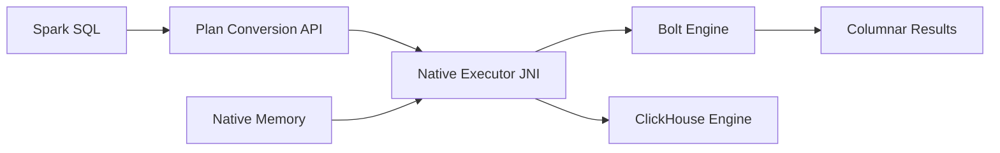

# apache/gluten

> Spark SQL plugin that delegates computation to native engines, an apparent duplicate of apache/incubator-gluten.

## The problem
Spark SQL's JVM engine hits a ceiling on per-operator performance; native engines do not understand Spark SQL.

## What it actually does
README identical to apache/incubator-gluten: conversion of the Spark plan to Substrait, JNI call to a native engine, Arrow results, fallback to Spark, metrics, columnar shuffle, Spark 3.4 to 4.1 shims. The described architecture shows the Bolt and ClickHouse backends, with Bolt and Velox memory management, and Iceberg writes.

## How it is wired


## Trying it
```bash
export GLUTEN_JAR=/PATH/TO/GLUTEN_JAR
spark-shell --conf spark.plugins=org.apache.gluten.GlutenPlugin \
  --conf spark.memory.offHeap.enabled=true --conf spark.memory.offHeap.size=20g
```

## Cost and gotchas
Free; high off-heap memory, heavy native build. Two repositories created the same day with the same README: which one to follow is not specified.

## What it is not
Not a distinct documented version: nothing indicates a difference from incubator-gluten. TPC-H figures are from 2023.

## Alternatives
apache/incubator-gluten, same content; Velox and ClickHouse as native engines.

## For you
Worth watching, but follow only one of the two repositories: the same project seen twice, of interest only for heavy Spark SQL workloads.
