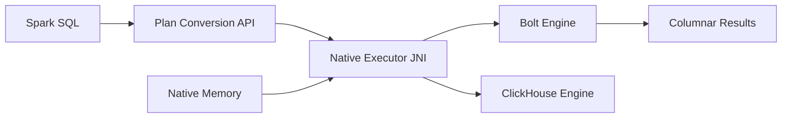

# apache/gluten

> Plugin Spark SQL qui délègue le calcul à des moteurs natifs, doublon apparent d'apache/incubator-gluten.

## Le problème
Le moteur JVM de Spark SQL plafonne sur les performances par opérateur ; les moteurs natifs ne comprennent pas Spark SQL.

## Ce que ça fait vraiment
README identique à apache/incubator-gluten : conversion du plan Spark en Substrait, appel JNI vers un moteur natif, résultats Arrow, repli sur Spark, métriques, shuffle colonnaire, shims Spark 3.4 à 4.1. L'architecture décrite montre les backends Bolt et ClickHouse, avec gestion mémoire Bolt et Velox, et l'écriture Iceberg.

## Comment c'est branché


## Essayer
```bash
export GLUTEN_JAR=/PATH/TO/GLUTEN_JAR
spark-shell --conf spark.plugins=org.apache.gluten.GlutenPlugin \
  --conf spark.memory.offHeap.enabled=true --conf spark.memory.offHeap.size=20g
```

## Coût et pièges
Gratuit ; mémoire off-heap élevée, build natif lourd. Deux dépôts créés le même jour avec le même README : lequel suivre n'est pas précisé.

## Ce que ce n'est pas
Pas une version distincte documentée : rien n'indique une différence avec incubator-gluten. Chiffres TPC-H de 2023.

## Alternatives
apache/incubator-gluten, même contenu ; Velox et ClickHouse comme moteurs natifs.

## Pour toi
À surveiller, mais suis un seul des deux dépôts : même projet vu deux fois, intérêt conditionné à de lourdes charges Spark SQL.

