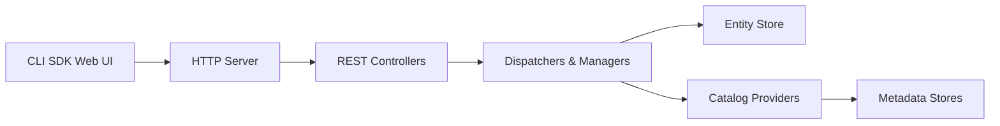

# apache/gravitino

> Federated, geo-distributed metadata catalog for data and AI assets, for data platform teams.

## The problem
Metadata is scattered across Hive, relational databases, object stores and engines, with no common view or governance.

## What it actually does
Java server exposing a unified REST API, connectors to sources (Hive, JDBC, Kafka, Iceberg, Paimon, Hudi) and storages (HDFS, S3, GCS, OSS, ADLS), authorization (Ranger, JDBC) and Spark, Flink and Trino connectors. Native Iceberg REST and Lance catalogs. AI asset management is marked as under development.

## How it is wired


## Trying it
```bash
./bin/gravitino.sh start
./bin/gravitino.sh stop
```

## Cost and gotchas
Java; Gradle with no Windows support. Docker Compose playground available. Several AI features are still in progress.

## What it is not
Not a query engine: it manages metadata, not data.

## Alternatives
- None cited in the README.

## For you
Worth watching: relevant for governing data lakes and models at scale; too heavy for a small project.
