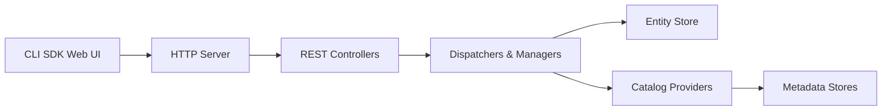

# apache/gravitino

> Catalogue de métadonnées fédéré et géo-distribué pour données et actifs d'IA, pour équipes de plateforme data.

## Le problème
Les métadonnées sont dispersées entre Hive, bases relationnelles, stockages objet et moteurs, sans vue ni gouvernance communes.

## Ce que ça fait vraiment
Serveur Java exposant une API REST unifiée, des connecteurs vers les sources (Hive, JDBC, Kafka, Iceberg, Paimon, Hudi) et les stockages (HDFS, S3, GCS, OSS, ADLS), des autorisations (Ranger, JDBC) et des connecteurs Spark, Flink et Trino. Catalogues REST Iceberg et Lance natifs. Gestion d'actifs IA marquée en cours de développement.

## Comment c'est branché


## Essayer
```bash
./bin/gravitino.sh start
./bin/gravitino.sh stop
```

## Coût et pièges
Java ; Gradle sans prise en charge de Windows. Playground Docker Compose disponible. Plusieurs fonctions d'IA sont encore en chantier.

## Ce que ce n'est pas
Pas un moteur de requêtes : il gère les métadonnées, pas les données.

## Alternatives
- Aucune citée dans le README.

## Pour toi
À surveiller : pertinent pour gouverner lac de données et modèles à grande échelle ; trop lourd pour un petit projet.

