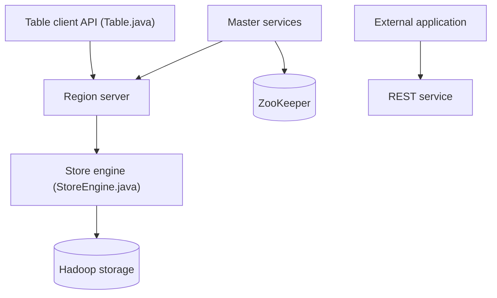

# apache/hbase

> Distributed column-oriented database inspired by Bigtable, built on Hadoop, for very large structured volumes.

## The problem
Storing and randomly reading billions of rows exceeds what a relational database on a single server can handle.

## What it actually does
HBase stores versioned column tables, split into regions served by region servers, with persistence on Hadoop storage. The repository also contains load balancing, replication, backup and restore, access permissions, and REST and Thrift interfaces. The README points to the reference guide to get started.

## How it is wired

## Trying it
The README gives no command: quick start in the online reference guide. Not documented here.

## Cost and gotchas
Free, but deployment assumes a Hadoop cluster, ZooKeeper and memory. A Jira account must be requested manually to contribute (up to a week).

## What it is not
Not a SQL database nor an analytics tool: a column key-value store. The repository is not a turnkey product.

## Alternatives
No alternative named in the README.

## For you
Ignore unless you inherit a Hadoop cluster: heavy to operate, and the README says nothing about a data/AI use.
