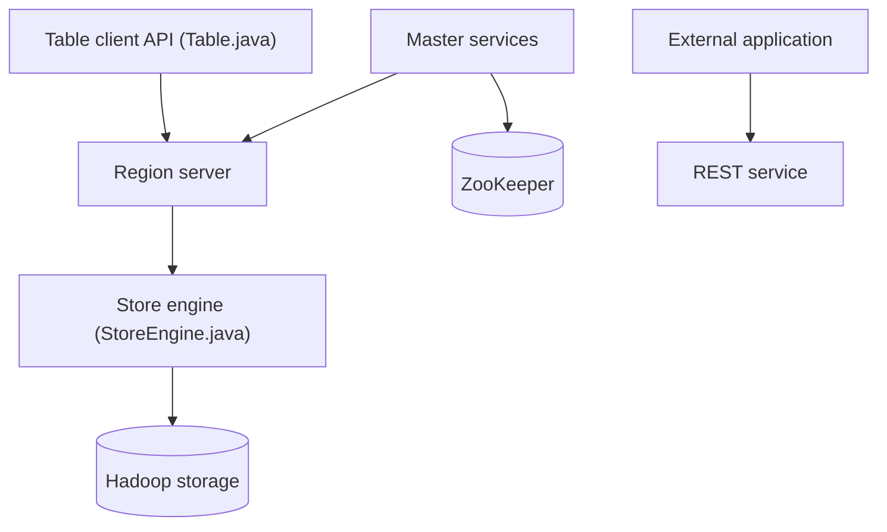

# apache/hbase

> Base distribuée en colonnes inspirée de Bigtable, adossée à Hadoop, pour très gros volumes structurés.

## Le problème
Stocker et lire en accès aléatoire des milliards de lignes dépasse ce que supporte une base relationnelle sur un seul serveur.

## Ce que ça fait vraiment
HBase stocke des tables versionnées en colonnes, découpées en régions servies par des serveurs de régions, avec persistance sur le stockage Hadoop. Le dépôt contient aussi la répartition de charge, la réplication, la sauvegarde et restauration, les permissions d'accès, et des interfaces REST et Thrift. Le README renvoie au guide de référence pour démarrer.

## Comment c'est branché

## Essayer
Le README ne donne aucune commande : démarrage rapide dans le guide de référence en ligne. Non documenté ici.

## Coût et pièges
Gratuit, mais le déploiement suppose un cluster Hadoop, ZooKeeper et de la mémoire. Compte Jira à demander manuellement pour contribuer (jusqu'à une semaine).

## Ce que ce n'est pas
Pas une base SQL ni un outil d'analyse : un magasin clé-valeur en colonnes. Le dépôt n'est pas un produit clé en main.

## Alternatives
Aucune alternative nommée dans le README.

## Pour toi
À ignorer sauf si tu hérites d'un cluster Hadoop : lourd à opérer, et le README ne dit rien d'un usage data/IA.

