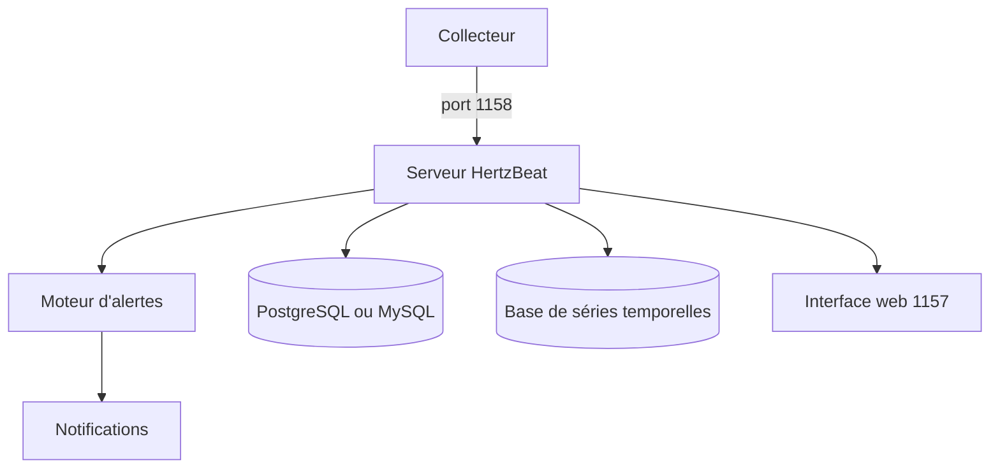

# apache/hertzbeat

> Open source real-time monitoring system: metrics, logs, alerts and status pages, agentless.

## The problem
Collecting, alerting and notifying often requires gluing several tools together.

## What it actually does
A single platform: agentless collection (HTTP, JMX, SSH, SNMP, JDBC, Prometheus), logs through OTLP, alert rules, notifications to Email, Slack, Discord, Telegram and others, status pages. Monitoring types are defined in YAML. Clustered collectors are possible. Built-in AI features and MCP server.

## How it is wired

Diagram not provided: simplified from the README.

## Trying it
```bash
docker run -d -p 1157:1157 -p 1158:1158 --name hertzbeat apache/hertzbeat
# http://localhost:1157, compte par défaut admin/hertzbeat
docker run -d -e IDENTITY=custom-collector-name -e MANAGER_HOST=127.0.0.1 -e MANAGER_PORT=1158 --name hertzbeat-collector apache/hertzbeat-collector
```

## Cost and gotchas
Free. Change the default password. For production, plan for a relational database and a time-series database.

## What it is not
Not a simple Prometheus client: it is a full platform with its own databases. The AI features come from the README, without detail.

## Alternatives
No alternative named in the README.

## For you
Adopt it if you need to monitor a serving or pipeline infrastructure: a single tool, under the Apache foundation.
