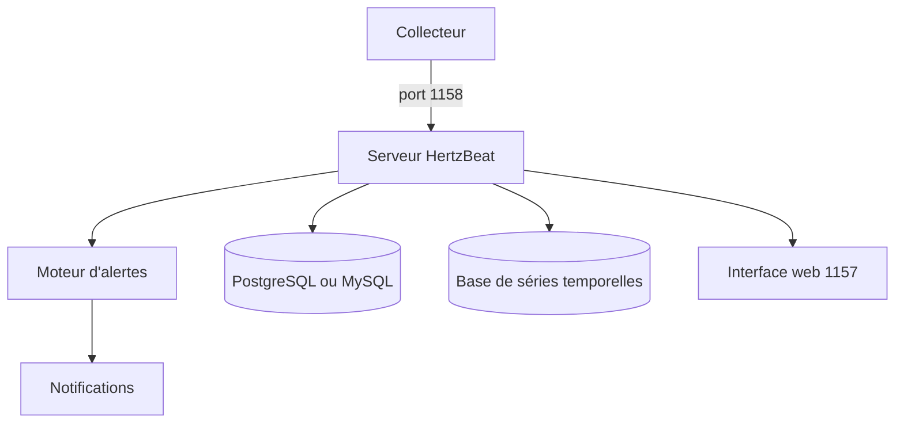

# apache/hertzbeat

> Système open source de supervision temps réel : métriques, journaux, alertes et pages de statut, sans agent.

## Le problème
Collecter, alerter et notifier demande souvent de coller plusieurs outils.

## Ce que ça fait vraiment
Une plateforme unique : collecte sans agent (HTTP, JMX, SSH, SNMP, JDBC, Prometheus), journaux par OTLP, règles d'alerte, notification vers Email, Slack, Discord, Telegram et autres, pages de statut. Les types de supervision se définissent en YAML. Collecteurs en cluster possibles. Fonctions IA et serveur MCP intégrés.

## Comment c'est branché

Schéma non fourni : diagramme simplifié d'après le README.

## Essayer
```bash
docker run -d -p 1157:1157 -p 1158:1158 --name hertzbeat apache/hertzbeat
# http://localhost:1157, compte par défaut admin/hertzbeat
docker run -d -e IDENTITY=custom-collector-name -e MANAGER_HOST=127.0.0.1 -e MANAGER_PORT=1158 --name hertzbeat-collector apache/hertzbeat-collector
```

## Coût et pièges
Gratuit. Changer le mot de passe par défaut. Pour de la production, prévoir base relationnelle et base de séries temporelles.

## Ce que ce n'est pas
Pas un simple client Prometheus : c'est une plateforme complète avec ses propres bases. Les fonctions IA relèvent du README, sans détail.

## Alternatives
Aucune alternative nommée dans le README.

## Pour toi
À adopter si tu dois superviser une infrastructure de serving ou de pipelines : un outil unique, sous fondation Apache.

