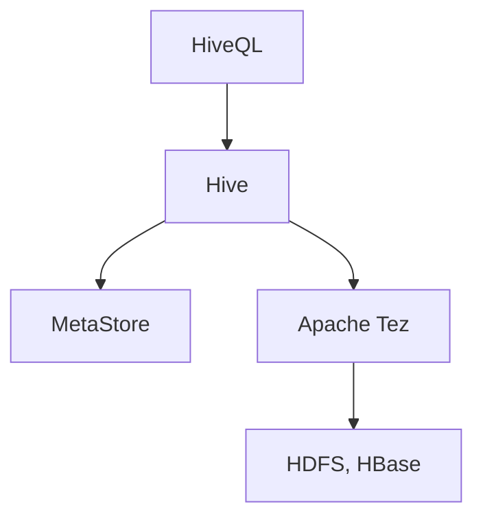

# apache/hive

> SQL data warehouse on Hadoop, for querying large volumes stored in distributed storage.

## The problem
Querying petabytes of distributed files with SQL without hand-writing MapReduce jobs.

## What it actually does
Imposes a structure on varied data formats through a metastore, and runs SQL (HiveQL, OLAP functions, subqueries, CTEs) on HDFS or HBase. Execution is done by Apache Tez. Extensible through UDFs, UDAFs and UDTFs.

## How it is wired

Simplified diagram based on the sheet, no diagram provided.

## Trying it
```bash
# Aucune commande dans le README : voir hive.apache.org/development/quickstart
# et la page gettingstarted-latest.
```

## Cost and gotchas
Free, but requires Hadoop 3.x and Java: 8 for Hive 4.0.1, 17 for 4.1.x, 21 for 4.2.x. An upgrade requires running the metastore schema migration scripts.

## What it is not
Not an OLTP database: the README says so. For transactional workloads, it is not the right tool. It only makes sense if the data justifies a distributed system.

## Alternatives
No alternative named in the README.

## For you
Worth watching: good to know for existing data lakes on Hadoop, of little relevance for a new project.
