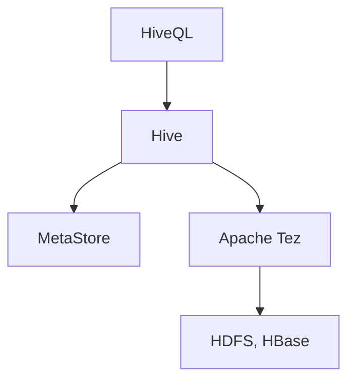

# apache/hive

> Entrepôt de données SQL sur Hadoop, pour interroger de gros volumes stockés en stockage distribué.

## Le problème
Interroger des pétaoctets de fichiers distribués en SQL sans écrire des jobs MapReduce à la main.

## Ce que ça fait vraiment
Impose une structure sur des formats de données variés, via un métastore, et exécute du SQL (HiveQL, fonctions OLAP, sous-requêtes, CTE) sur HDFS ou HBase. Exécution par Apache Tez. Extensible par UDF, UDAF et UDTF.

## Comment c'est branché

Schéma simplifié d'après la fiche, sans diagramme fourni.

## Essayer
```bash
# Aucune commande dans le README : voir hive.apache.org/development/quickstart
# et la page gettingstarted-latest.
```

## Coût et pièges
Gratuit, mais exige Hadoop 3.x et Java : 8 pour Hive 4.0.1, 17 pour 4.1.x, 21 pour 4.2.x. Une mise à jour impose de lancer les scripts de migration du schéma du métastore.

## Ce que ce n'est pas
Pas une base OLTP : le README le dit. Pour du transactionnel, ce n'est pas l'outil. Il n'a de sens que si les données justifient un système distribué.

## Alternatives
Aucune alternative nommée dans le README.

## Pour toi
À surveiller : à connaître pour des lacs de données existants sous Hadoop, peu pertinent pour un nouveau projet.

