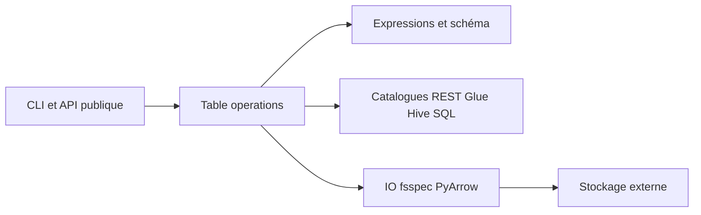

# apache/iceberg-python

> PyIceberg: Python library to read the metadata and data of Apache Iceberg tables.

## The problem
Querying or modifying Iceberg tables from Python without going through Spark or a JVM engine.

## What it actually does
The README says almost nothing: PyIceberg is the Python implementation of the Iceberg table specification, with online documentation. From the code: CLI, table operations, expressions, schemas and types, catalogs (REST, Glue, Hive, SQL, DynamoDB), I/O through fsspec and PyArrow, Avro reading and writing.

## How it is wired

## Trying it
No command documented in the README; see the online documentation.

## Cost and gotchas
The catalog and the storage (S3, etc.) are on you. The pip package name is not given in the README. 269 open issues.

## What it is not
Not a query engine: it gives access to the tables and metadata.

## Alternatives
No alternative named in the README.

## For you
Adopt: an active Apache project that gives you Iceberg tables from Python, provided you read the online documentation, since the README has no content.
