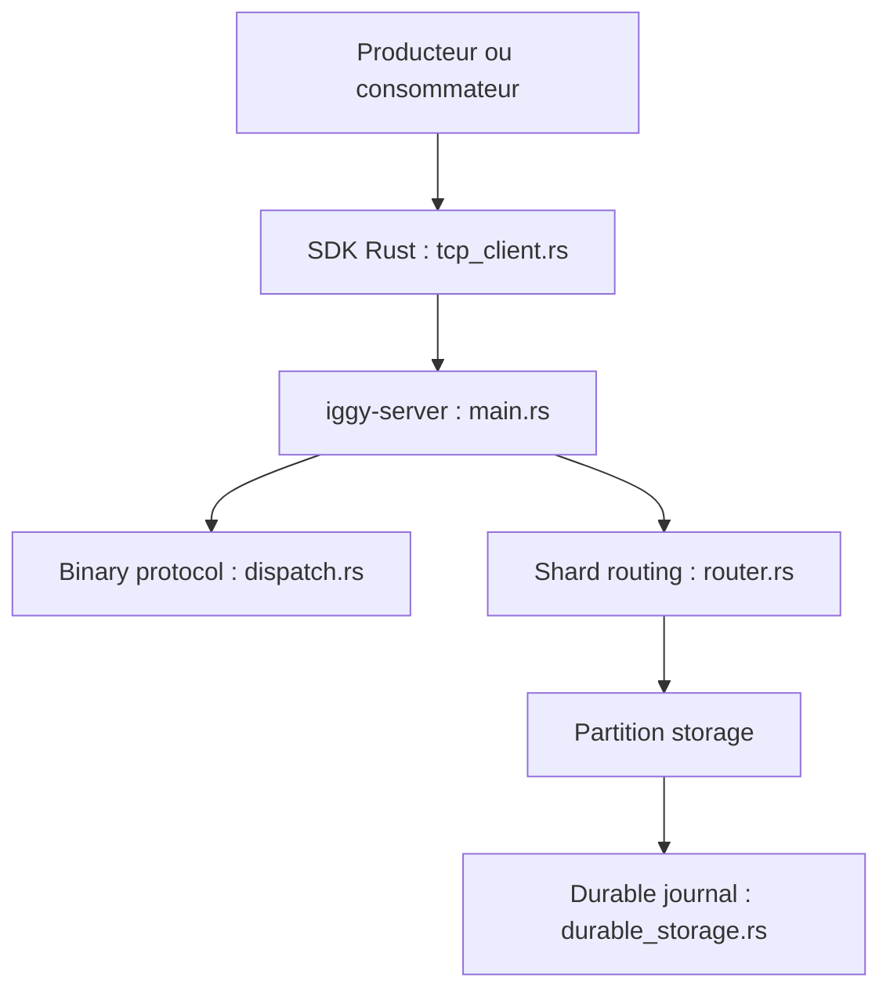

# apache/iggy

> Persistent message streaming platform in Rust, multi-protocol, with no external broker or database.

## The problem
Kafka is heavy to operate; you want a fast, light message log with predictable latency.

## What it actually does
Iggy is an append-only log with streams, topics, partitions and consumer groups, reachable over QUIC, TCP, WebSocket and HTTP. It offers server-side offsets, expiration, deduplication, AES-256-GCM encryption, token-based authentication, a connector runtime (Source and Sink in Rust), an MCP server and cluster replication (VSR). A single binary, with a client in several languages.

## How it is wired


## Trying it
```bash
export IGGY_ROOT_USERNAME=iggy
export IGGY_ROOT_PASSWORD=iggy
cargo run --bin iggy-server
cargo run --bin iggy -- --transport tcp --username iggy --password iggy stream create dev
```

## Cost and gotchas
Free. The Docker image requires `SYS_NICE`, seccomp disabled and unlimited locked memory; performance relies on `io_uring`, hence on Linux. The current repository breaks protocol (0.12.0) and data compatibility. The Kafka gateway is still under development.

## What it is not
It is not a ready-made replacement for Kafka: server-side compression does not exist yet, and the server's OTLP export is unavailable. No enforced schema.

## Alternatives
Kafka is cited as the existing infrastructure that Iggy aims to do without.

## For you
Worth watching: interesting for light real-time streaming in an MLOps stack, but the protocol is still moving and durability needs to be validated.
