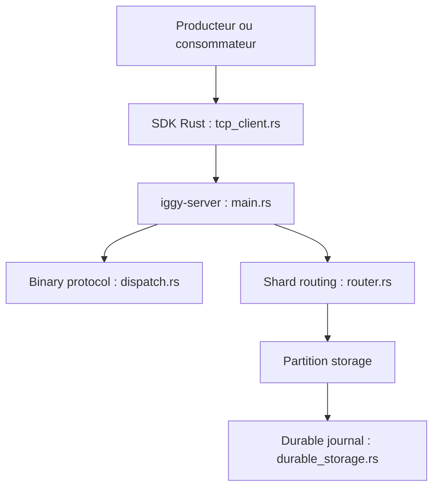

# apache/iggy

> Plateforme de streaming de messages persistante en Rust, multi-protocoles, sans courtier ni base externes.

## Le problème
Kafka est lourd à exploiter ; on veut un journal de messages rapide, léger et à latence prévisible.

## Ce que ça fait vraiment
Iggy est un journal en ajout seul avec streams, topics, partitions et groupes de consommateurs, accessible en QUIC, TCP, WebSocket et HTTP. Il propose offsets côté serveur, expiration, déduplication, chiffrement AES-256-GCM, authentification par jetons, un runtime de connecteurs (Source et Sink en Rust), un serveur MCP et une réplication en grappe (VSR). Un seul binaire, un client en plusieurs langages.

## Comment c'est branché


## Essayer
```bash
export IGGY_ROOT_USERNAME=iggy
export IGGY_ROOT_PASSWORD=iggy
cargo run --bin iggy-server
cargo run --bin iggy -- --transport tcp --username iggy --password iggy stream create dev
```

## Coût et pièges
Gratuit. L'image Docker exige `SYS_NICE`, seccomp désactivé et mémoire verrouillée illimitée ; les performances reposent sur `io_uring`, donc sur Linux. Le dépôt courant casse la compatibilité du protocole (0.12.0) et des données. La passerelle Kafka est encore en développement.

## Ce que ce n'est pas
Ce n'est pas une alternative prête à remplacer Kafka : la compression côté serveur n'existe pas encore, et l'export OTLP du serveur est indisponible. Pas de schéma imposé.

## Alternatives
Kafka est cité comme infrastructure existante, dont Iggy veut se passer.

## Pour toi
À surveiller : intéressant pour du streaming temps réel léger dans une pile MLOps, mais le protocole bouge encore et il faut valider la durabilité.

