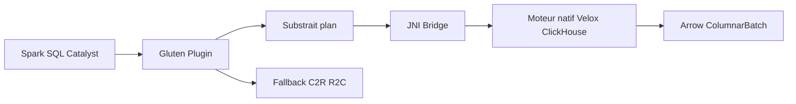

# apache/incubator-gluten

> Spark SQL plugin that delegates computation to native engines (Velox, ClickHouse) to speed up queries.

## The problem
Spark SQL's JVM engine hits a ceiling on per-operator performance; vectorized native engines do not understand Spark SQL.

## What it actually does
Converts the Spark physical plan into a Substrait plan, sends it through JNI to a native engine (Velox, ClickHouse, and Bolt in the README), and returns Arrow ColumnarBatches. Keeps Spark's distributed control, with columnar shuffle, fallback to Spark for unsupported operators, metrics in the Spark UI and a compatibility layer (Spark 3.4, 3.5, 4.0, 4.1). A qualification tool is provided.

## How it is wired


## Trying it
```bash
export GLUTEN_JAR=/PATH/TO/GLUTEN_JAR
spark-shell \
  --master yarn --deploy-mode client \
  --conf spark.plugins=org.apache.gluten.GlutenPlugin \
  --conf spark.memory.offHeap.enabled=true \
  --conf spark.memory.offHeap.size=20g
```

## Cost and gotchas
Free. Significant off-heap memory (20 g in the example) and a heavy native build. The TPC-H figures date from June 2023, and the README states they do not reflect current performance.

## What it is not
Not a new engine: it depends on Velox/ClickHouse. The announced gains (2.71× on average) come from the project's own tests. 1,097 open issues.

## Alternatives
Velox and ClickHouse, cited as native engines; the README names no other Spark accelerator.

## For you
Worth watching: relevant if you have costly Spark SQL workloads, to be validated on your own queries before believing it.
