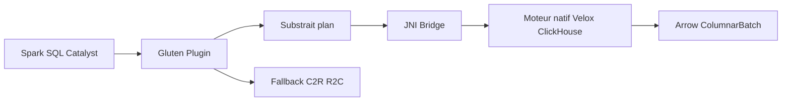

# apache/incubator-gluten

> Plugin Spark SQL qui délègue le calcul à des moteurs natifs (Velox, ClickHouse) pour accélérer les requêtes.

## Le problème
Le moteur JVM de Spark SQL plafonne sur les performances par opérateur ; les moteurs natifs vectorisés ne comprennent pas Spark SQL.

## Ce que ça fait vraiment
Convertit le plan physique Spark en plan Substrait, l'envoie par JNI à un moteur natif (Velox, ClickHouse, et Bolt dans le README), renvoie des ColumnarBatch Arrow. Garde le contrôle distribué de Spark, avec shuffle colonnaire, repli sur Spark pour les opérateurs non gérés, métriques dans l'UI Spark et couche de compatibilité (Spark 3.4, 3.5, 4.0, 4.1). Outil de qualification fourni.

## Comment c'est branché


## Essayer
```bash
export GLUTEN_JAR=/PATH/TO/GLUTEN_JAR
spark-shell \
  --master yarn --deploy-mode client \
  --conf spark.plugins=org.apache.gluten.GlutenPlugin \
  --conf spark.memory.offHeap.enabled=true \
  --conf spark.memory.offHeap.size=20g
```

## Coût et pièges
Gratuit. Mémoire off-heap importante (20 g dans l'exemple) et compilation native lourde. Les chiffres TPC-H datent de juin 2023, le README précise qu'ils ne reflètent pas les performances actuelles.

## Ce que ce n'est pas
Pas un nouveau moteur : il dépend de Velox/ClickHouse. Les gains annoncés (2,71× moyen) viennent des tests du projet. 1 097 issues ouvertes.

## Alternatives
Velox et ClickHouse, cités comme moteurs natifs ; le README ne nomme pas d'autre accélérateur Spark.

## Pour toi
À surveiller : pertinent si tu as des charges Spark SQL coûteuses, à valider sur tes propres requêtes avant d'y croire.

