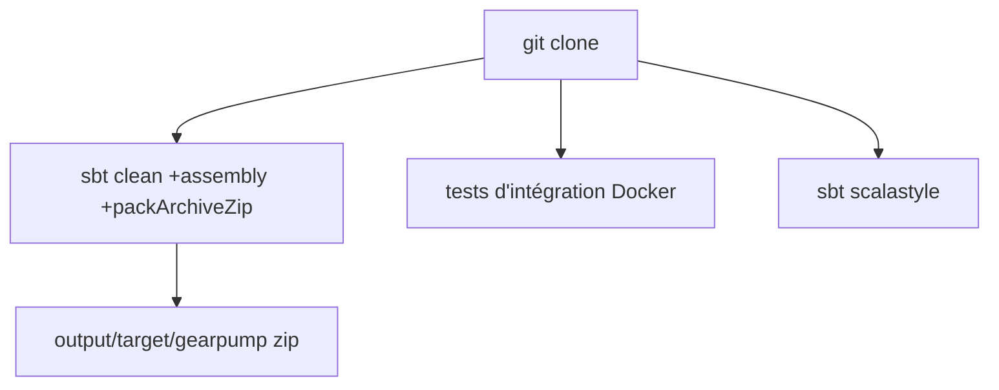

# apache/incubator-retired-gearpump

> Real-time stream processing engine on Akka, retired from the Apache incubator.

## The problem
The README does not state it: it only contains resources, build instructions and contacts.

## What it actually does
Based on the README alone: a Scala project built with sbt (Scala 2.10 or 2.11) that produces a zip, with integration tests under Docker and a `scalastyle` style check. How it works is not described: undocumented.

## How it is wired
Simplified diagram based on the sheet, no diagram provided.


## Trying it
```bash
git clone https://github.com/apache/incubator-gearpump.git
cd gearpump
sbt clean +assembly +packArchiveZip
sbt unidoc
```

## Cost and gotchas
Scala 2.10 or 2.11 and sbt, network needed for the build. Archived, last push in 2018: no more maintenance.

## What it is not
Not an active project nor a modern alternative to Flink or Spark Streaming.

## Alternatives
No alternative named in the README.

## For you
Ignore: retired and abandoned since 2018, not to be adopted.
