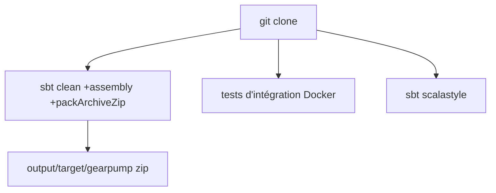

# apache/incubator-retired-gearpump

> Moteur de traitement de flux en temps réel sur Akka, retiré de l'incubateur Apache.

## Le problème
Le README ne l'énonce pas : il ne contient que des ressources, des instructions de build et des contacts.

## Ce que ça fait vraiment
D'après le README seul : un projet Scala compilé avec sbt (Scala 2.10 ou 2.11) qui produit un zip, avec des tests d'intégration sous Docker et un contrôle de style `scalastyle`. Le fonctionnement n'est pas décrit : non documenté.

## Comment c'est branché
Schéma simplifié d'après la fiche, sans diagramme fourni.


## Essayer
```bash
git clone https://github.com/apache/incubator-gearpump.git
cd gearpump
sbt clean +assembly +packArchiveZip
sbt unidoc
```

## Coût et pièges
Scala 2.10 ou 2.11 et sbt, réseau nécessaire au build. Archivé, dernier push en 2018 : plus de maintenance.

## Ce que ce n'est pas
Pas un projet actif ni une alternative moderne à Flink ou Spark Streaming.

## Alternatives
Aucune alternative nommée dans le README.

## Pour toi
Ignorer : retiré et abandonné depuis 2018, à ne pas adopter.

