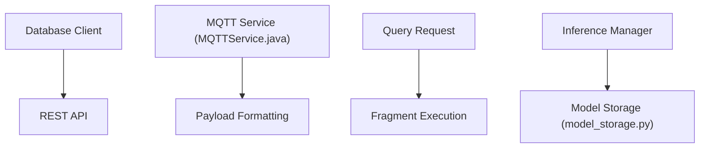

# apache/iotdb

> Apache time-series database for industrial IoT: collection, storage and analysis.

## The problem
Industrial sensors produce large volumes of time series, hard to store and query with a conventional database.

## What it actually does
Stores series organized by database and by device, with compression and SQL-like queries via a CLI or JDBC. Access through REST API, Grafana and MQTT. Pipe plugins, triggers and user-defined functions. Hadoop and Spark integration, and an AI inference module for models. An Edge version fits in a single JVM.

## How it is wired
Diagram taken from the code, simplified.



## Trying it
```bash
mvn clean package -pl distribution -am -DskipTests
sbin/start-standalone.sh
sbin/start-cli.sh -h 127.0.0.1 -p 6667 -u root -pw root
```

## Cost and gotchas
Free. Java 17 to 25 required. System limits to raise (open files to 65535). `root` account with password `root` by default: change it. Building from source requires Thrift and other tools.

## What it is not
Not a simple analysis tool: it is a database to operate. The README does not document the link between all the listed features.

## Alternatives
No alternative named in the README.

## For you
Worth watching: relevant for storing sensor series before passing them to models, especially with Grafana and Spark.
