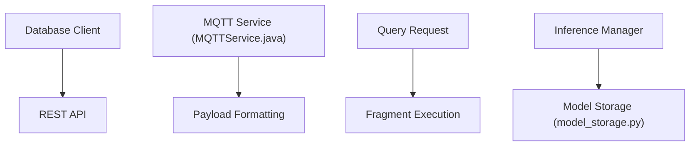

# apache/iotdb

> Base de données de séries temporelles Apache pour l'IoT industriel : collecte, stockage et analyse.

## Le problème
Les capteurs industriels produisent de gros volumes de séries temporelles, difficiles à stocker et interroger avec une base classique.

## Ce que ça fait vraiment
Stocke des séries organisées par base et par appareil, avec compression et requêtes de type SQL via une CLI ou JDBC. Accès par API REST, Grafana et MQTT. Plugins pipe, triggers et fonctions utilisateur. Intégration Hadoop, Spark, et un module d'inférence IA pour les modèles. Une version Edge tient dans une seule JVM.

## Comment c'est branché
Diagramme tiré du code, simplifié.



## Essayer
```bash
mvn clean package -pl distribution -am -DskipTests
sbin/start-standalone.sh
sbin/start-cli.sh -h 127.0.0.1 -p 6667 -u root -pw root
```

## Coût et pièges
Gratuit. Java 17 à 25 requis. Limites système à relever (fichiers ouverts à 65535). Compte `root` avec mot de passe `root` par défaut : à changer. Construire depuis les sources demande Thrift et d'autres outils.

## Ce que ce n'est pas
Pas un simple outil d'analyse : c'est une base à exploiter. Le README ne documente pas le lien entre toutes les fonctions listées.

## Alternatives
Aucune alternative nommée dans le README.

## Pour toi
À surveiller : pertinent pour stocker des séries de capteurs avant de les passer à des modèles, surtout avec Grafana et Spark.

