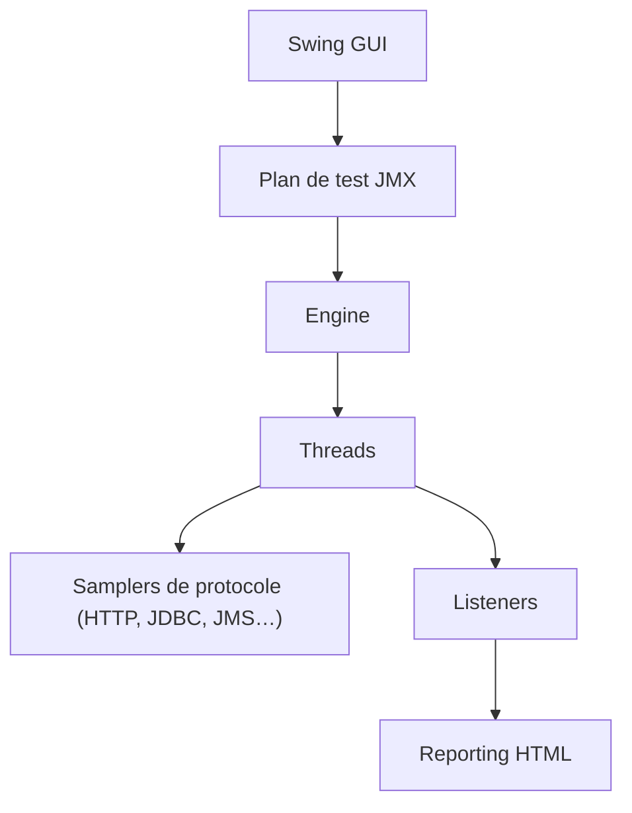

# apache/jmeter

> Java load and performance testing application for websites, APIs and servers.

## The problem
Knowing how a service holds up under load requires simulating many users in a reproducible way.

## What it actually does
Runs test plans (JMX files) with threads that query HTTP, REST, JDBC, JMS, LDAP, TCP, FTP, mail. Graphical interface for recording and debugging, command-line mode, HTML report, metrics export to InfluxDB or Graphite. Extensible through plugins and Groovy scripts.

## How it is wired


## Trying it
```bash
cd bin
./jmeter
./gradlew build
./gradlew createDist
./gradlew runGui
```

## Cost and gotchas
Free. Java 17 required, absent from the prerequisites list: `[aucun]` here. Spaces in paths cause problems. Some jars (JDBC, JMS) must be downloaded. 992 open issues.

## What it is not
Not a browser: it does not render JavaScript. Not a production observability tool.

## Alternatives
No alternative named in the README.

## For you
Adopt if you need to measure the load of a model API or a data service: mature tool, backed by a foundation, no license cost.
