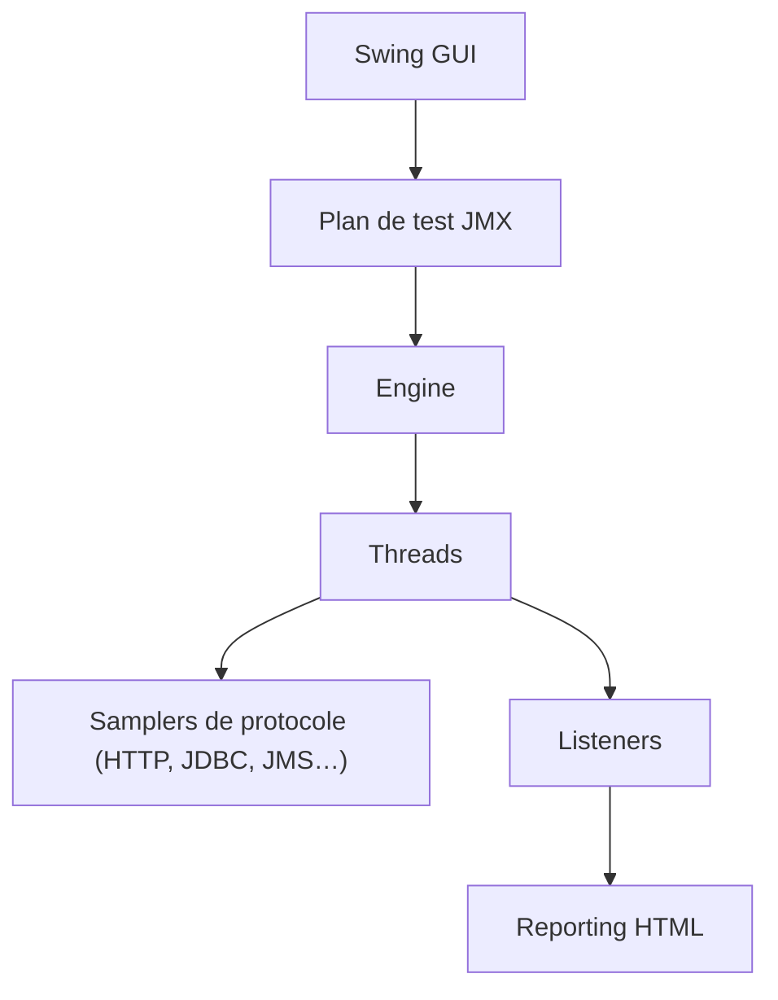

# apache/jmeter

> Application Java de test de charge et de performance pour sites, API et serveurs.

## Le problème
Savoir comment un service tient sous charge demande de simuler beaucoup d'utilisateurs de façon reproductible.

## Ce que ça fait vraiment
Exécute des plans de test (fichiers JMX) avec des threads qui interrogent HTTP, REST, JDBC, JMS, LDAP, TCP, FTP, mail. Interface graphique pour enregistrer et déboguer, mode ligne de commande, rapport HTML, envoi de métriques vers InfluxDB ou Graphite. Extensible par plugins et scripts Groovy.

## Comment c'est branché


## Essayer
```bash
cd bin
./jmeter
./gradlew build
./gradlew createDist
./gradlew runGui
```

## Coût et pièges
Gratuit. Java 17 requis, hors liste des prérequis : `[aucun]` ici. Les espaces dans les chemins posent problème. Certains jars (JDBC, JMS) sont à télécharger. 992 issues ouvertes.

## Ce que ce n'est pas
Pas un navigateur : il ne rend pas JavaScript. Pas un outil d'observabilité de production.

## Alternatives
Aucune alternative nommée dans le README.

## Pour toi
À adopter si tu dois mesurer la charge d'une API de modèle ou d'un service de données : outil mûr, soutenu par une fondation, sans coût de licence.

