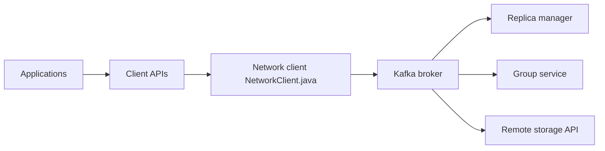

# apache/kafka

> Distributed event streaming platform, for data pipelines and real-time applications.

## The problem
Transporting and retaining large streams of events between applications durably and at high throughput.

## What it actually does
Brokers store logs of records; producers and consumers go through the client APIs, with consumer groups, share groups, remote storage and administration tools. The README is mostly a guide to building (Gradle), testing, code quality and benchmarking. Java 17 and 25 are tested.

## How it is wired


## Trying it
```bash
docker run -p 9092:9092 apache/kafka:latest
./gradlew jar
KAFKA_CLUSTER_ID="$(./bin/kafka-storage.sh random-uuid)"
./bin/kafka-storage.sh format --standalone -t $KAFKA_CLUSTER_ID -c config/server.properties
./bin/kafka-server-start.sh config/server.properties
```

## Cost and gotchas
Free, but running a cluster (storage, monitoring, upgrades) is on you. Java required.

## What it is not
Not an analytics tool nor a data warehouse: it is an event bus. The README describes the project's development more than its use.

## Alternatives
No alternative named in the README.

## For you
Worth watching: a reference for ingesting streams (real-time features, inference logs); adopt only if the volume justifies running it.
