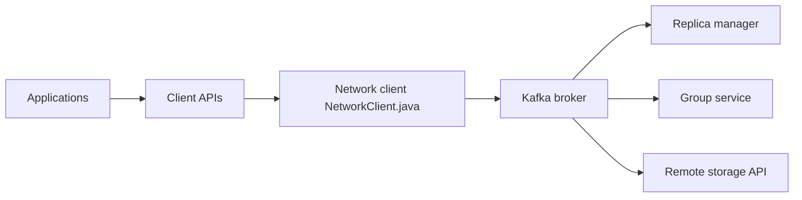

# apache/kafka

> Plateforme distribuée de streaming d'événements, pour pipelines de données et applications temps réel.

## Le problème
Transporter et conserver de gros flux d'événements entre applications de façon durable et à fort débit.

## Ce que ça fait vraiment
Des brokers stockent des journaux d'enregistrements ; producteurs et consommateurs passent par les API clientes, avec groupes de consommateurs, groupes de partage, stockage distant et outils d'administration. Le README est surtout un guide de build (Gradle), de test, de qualité de code et de benchmark. Java 17 et 25 sont testés.

## Comment c'est branché


## Essayer
```bash
docker run -p 9092:9092 apache/kafka:latest
./gradlew jar
KAFKA_CLUSTER_ID="$(./bin/kafka-storage.sh random-uuid)"
./bin/kafka-storage.sh format --standalone -t $KAFKA_CLUSTER_ID -c config/server.properties
./bin/kafka-server-start.sh config/server.properties
```

## Coût et pièges
Gratuit, mais l'exploitation d'un cluster (stockage, supervision, mises à jour) est à ta charge. Java requis.

## Ce que ce n'est pas
Pas un outil d'analytique ni un entrepôt de données : c'est un bus d'événements. Le README décrit le développement du projet plus que son usage.

## Alternatives
Aucune alternative nommée dans le README.

## Pour toi
À surveiller : référence pour ingérer des flux (features temps réel, logs d'inférence) ; à adopter seulement si le volume justifie son exploitation.

