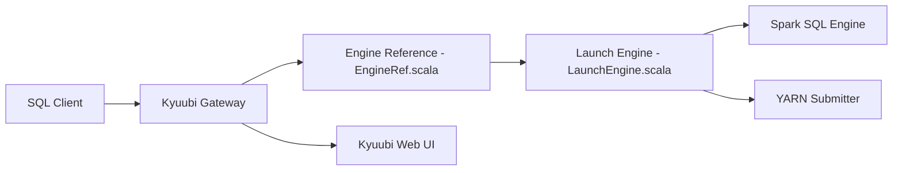

# apache/kyuubi

> Multi-tenant SQL gateway exposing Spark and other engines in serverless mode via JDBC/ODBC.

## The problem
The Spark Thrift Server is a single Spark application, coupled to its driver: no per-user isolation, no high availability, no strong concurrency.

## What it actually does
A Kyuubi server (HiveServer2-style API, Thrift JDBC/ODBC interface) authenticates the client, launches or reuses a Spark SQL engine per user and relays the queries. The README only mentions Spark; the code architecture also mentions Flink and Hive engines, YARN, a web interface and a UI proxy.

## How it is wired

## Trying it
No commands in the README: it points to the "Getting Started" guide. Not documented here.

## Cost and gotchas
Free, but assumes a cluster (YARN, Kubernetes) and a team of Spark administrators. 543 open issues.

## What it is not
Not a compute engine: it goes through Spark. Not an "administrator-free" solution: the README provides for a group of experts to deploy and tune it.

## Alternatives
Spark Thrift Server and HiveServer2 (cited as a starting point).

## For you
Watch: relevant if you share a Spark cluster between several teams; useless for individual use.
