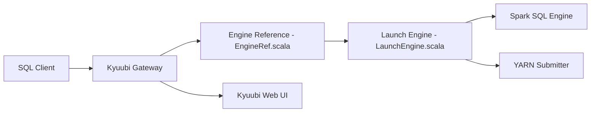

# apache/kyuubi

> Passerelle SQL multi-tenant exposant Spark et d'autres moteurs en mode serverless via JDBC/ODBC.

## Le problème
Le Spark Thrift Server est une seule application Spark, couplée à son driver : pas d'isolation par utilisateur, ni de haute disponibilité, ni de forte concurrence.

## Ce que ça fait vraiment
Un serveur Kyuubi (API type HiveServer2, interface Thrift JDBC/ODBC) authentifie le client, lance ou réutilise un moteur Spark SQL par utilisateur et relaie les requêtes. Le README ne cite que Spark ; l'architecture du code mentionne aussi des moteurs Flink et Hive, YARN, une interface web et un proxy d'UI.

## Comment c'est branché

## Essayer
Aucune commande dans le README : il renvoie au guide « Getting Started ». Non documenté ici.

## Coût et pièges
Gratuit, mais suppose un cluster (YARN, Kubernetes) et une équipe d'administrateurs Spark. 543 issues ouvertes.

## Ce que ce n'est pas
Pas un moteur de calcul : il passe par Spark. Pas une solution « sans administrateur » : le README prévoit un groupe d'experts pour déployer et régler.

## Alternatives
Spark Thrift Server et HiveServer2 (cités comme point de départ).

## Pour toi
Surveiller : pertinent si tu partages un cluster Spark entre plusieurs équipes ; inutile pour un usage individuel.

