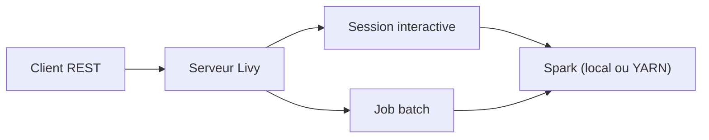

# apache/livy

> REST server for submitting Apache Spark code and jobs from anywhere.

## The problem
Running code on a Spark cluster forces you to install Spark and its access on every client machine.

## What it actually does
Livy exposes a REST API to Spark, locally or on YARN: interactive Scala, Python and R shells, batch submissions in Scala, Java, Python. Several users share the server with impersonation, without modifying their programs. A Spark installation is needed alongside.

## How it is wired
Simplified diagram based on the sheet, no diagram provided.



## Trying it
```bash
git clone https://github.com/apache/livy.git
cd livy
mvn package
```

## Cost and gotchas
Free. Maven build; by default Spark 4.1.2, Scala 2.13 and JDK 17 or 21, and `-Pspark3 -Pscala-2.12` profiles for Spark 3. A separate Spark is required.

## What it is not
Not a compute engine: it relays to Spark. The README does not describe authentication or operations, referring to the website.

## Alternatives
No alternative cited in the README.

## For you
Watch: useful for exposing Spark to notebooks or services, but compare with direct connections. Same content as apache/incubator-livy.
